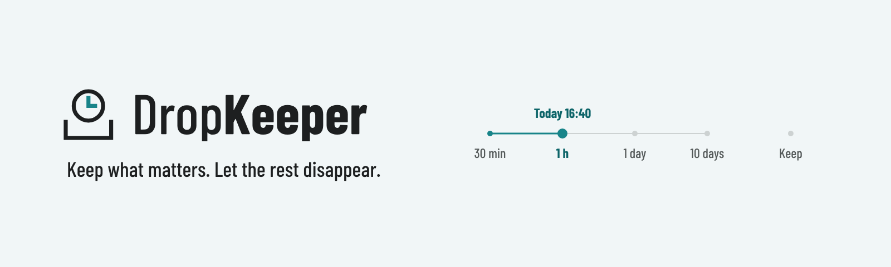
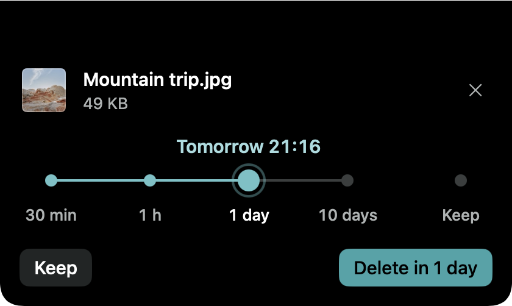
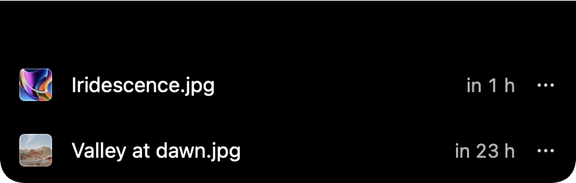
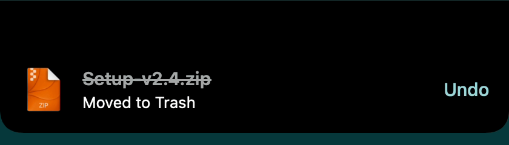

<picture>
  <source media="(prefers-color-scheme: dark)" srcset="assets/readme/dropkeeper-readme-header-dark.png">
  
</picture>

# DropKeeper

**Website: <https://direcat.github.io/dropkeeper/>**

Keep what matters. Let the rest disappear. When a file lands in a watched folder, DropKeeper asks how long it should stay — half an hour, a day, ten days, or for good. Expired files go to the Trash, so you can still bring them back.

- **100 % offline** — no analytics, no tracking, no update checks, no network access at all. Enforced in CI.
- **Free and open source** (MIT).
- **Works on any display setup** — a prompt under the menu bar icon, or (optional) from the notch.
- **Several watched folders** — Downloads by default, add Desktop or any other folder.
- **Speaks your language** — English, Czech, German, Spanish and French, switchable in Settings.
- Apple Silicon, macOS 15 Sequoia or later.

### Screenshots

<table>
  <tr>
    <td align="center" width="40%"> Pick when a new download goes.</td>
    <td align="center" width="30%"> See what is tracked and when it leaves.</td>
    <td align="center" width="30%"> Changed your mind? Undo.</td>
  </tr>
</table>

## How it works

A new file lands in a watched folder, a small prompt opens, and you pick when it should go: 30 minutes, an hour, a day, ten days — or keep it. When the time is up, DropKeeper moves the file to the Trash (Undo is one click away). Rename it or move it into a subfolder and it is still tracked; move it out of the watched folders and it is kept. Files that were there before you installed DropKeeper are never touched.

## Install

### Homebrew

    brew install --cask direcat/tap/dropkeeper

The cask needs Homebrew 7 or newer (run `brew update` first).

DropKeeper is not notarized by Apple (that needs a paid developer account). The cask therefore removes the macOS quarantine flag from the app after installing it, so it opens normally. If you prefer to keep Gatekeeper's check, install manually instead.

### Manual

1. Download `DropKeeper-<version>.dmg` (or `.zip`) from [Releases](https://github.com/direcat/dropkeeper/releases).
2. Drag DropKeeper to Applications.
3. macOS blocks unnotarized apps on first launch. Either open **System Settings → Privacy & Security** and click **Open Anyway**, or run:

       xattr -dr com.apple.quarantine /Applications/DropKeeper.app

On first launch DropKeeper asks for access to your Downloads folder.

## Privacy

DropKeeper never sends anything anywhere. There is no networking code in the app: CI fails if any networking API appears in the sources or the release binary links a networking framework. File names, contents and history stay in a local database on your Mac (`~/Library/Application Support/DropKeeper`). Expired files go to the Trash by default, so nothing is gone until you empty it.

## Build from source

Requirements: Apple Silicon Mac, macOS 15+, Xcode 26 or newer, [XcodeGen](https://github.com/yonaskolb/XcodeGen).

    brew install xcodegen
    xcodegen generate
    open DropKeeper.xcodeproj

- Core engine tests: `swift test --package-path Packages/DropKeeperCore`
- App tests: `xcodebuild test -project DropKeeper.xcodeproj -scheme DropKeeper -destination 'platform=macOS,arch=arm64'`
- Safe test runs and the manual checklist: [QA-CHECKLIST.md](QA-CHECKLIST.md)

See [CONTRIBUTING.md](CONTRIBUTING.md) for the rules (offline guard, lint, localization).

## Credits and transparency

DropKeeper is a functional open-source clone of [TempCat](https://voprexlabs.com/tempcat/) by Voprex Labs, and fully inspired by it. In the age of AI agents, selling small (if useful) utilities for money no longer feels like a viable model, so this one is free and open.

DropKeeper is AI-coded. That is what makes it possible for it to exist at all, for free and as open source. If that is a problem for you, that is completely fine — you don't have to use it.

## License

MIT — see [LICENSE](LICENSE).
